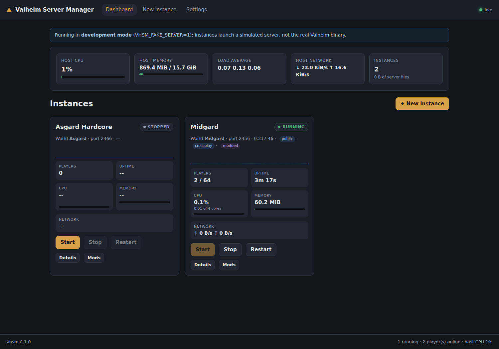
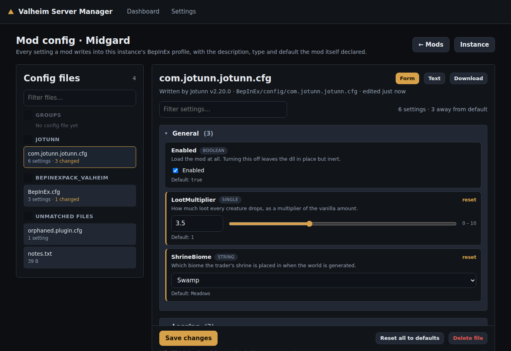

# Valheim Server Manager (vhsm)

A web GUI for running several Valheim dedicated servers on one host: create and
configure instances, start and stop them, watch live resource usage and player
counts, and manage mods per instance the way r2modman does on the desktop.

This is a first working version — the core of each area is implemented and
tested end to end, and the structure is meant to be built on.



## What works today

**Instances**
- Create, edit and delete instances from the GUI; each lives in its own
  directory and is described by an `instance.json`, so it can be copied,
  backed up or restored by moving a folder.
- Full launch configuration: name, world, password, port, public/crossplay,
  world preset and the five world modifiers, autosave and backup intervals,
  and free-form extra arguments.
- Validation mirrors what the server itself enforces (password length, the
  password not appearing in the server or world name, public servers needing a
  password) plus port-range collision checks between instances.

**Lifecycle**
- Start/stop/restart. Each server runs in its own process session, and stopping
  sends `SIGINT` first — Valheim's graceful shutdown, which saves the world —
  escalating to `SIGTERM` then `SIGKILL` only if it does not comply.
- Lifecycle actions run as manager-owned background tasks, so a browser that
  navigates away (or a button that re-renders mid-request) cannot abandon a
  restart half-finished. The UI shows `starting` / `stopping` / `restarting`
  while the work is in flight.
- A stop does not return until the exit has been read and the status is
  settled, which is what makes a restart a restart: starting an instance that
  still looks active is refused, so a stop that reported itself done a moment
  early took the server down and left it down — by hand, around an update, and
  after a mod update alike.
- Console output is streamed to the browser over a websocket and mirrored to
  `logs/console.log`. A line repeated faster than anyone could read it — a
  server stuck in a retry loop — is collapsed into a periodic count, so the
  loop cannot fill the disk or push everything before it out of the console.
  Player tracking and version detection still see every line.

**Monitoring**
- Per-instance CPU, RSS, memory share, thread count and disk I/O via `psutil`,
  rolled up over the process tree. CPU is shown as a share of the whole host
  with the core count alongside: psutil's raw figure is summed across cores, so
  a server using three cores reports 300%, which reads as a broken gauge.
- The running server's version, taken from its console banner and confirmed
  against the Steam query response, on every card.
- Live player count from the Steam A2S query socket (`game port + 1`), with
  player *names* and platform ids parsed from the console log, since A2S does
  not report them reliably for Valheim. Each connected player shows their id,
  platform and playtime; admin/ban/permit state lives on the Players roster.
- Per-instance network throughput via nftables counters on each instance's UDP
  port range. Linux has no per-process byte counters, so this is the honest way
  to get it; it needs root. Without it the UI says so and still shows host-wide
  traffic rather than pretending.
- Host CPU, memory, load average and network in the dashboard header.
- A **client visibility** probe on each instance that queries the server the way
  a Valheim client does and reports the UDP sockets the process actually holds,
  so "shows as unreachable in the client" can be told apart from "the game port
  is fine".

**Players and moderation**
- A roster of everyone who has ever joined, kept across restarts. Valheim's
  console is the only source of player identity a stock server offers and it
  says nothing about anyone not currently connected, so moderating someone who
  left an hour ago means having written down that they were here.
- Per player: names used, platform id, session count, time played, last seen
  ("now" while online, otherwise a timestamp) and a bounded log of their
  connects, spawns, deaths and disconnects — downloadable as a text file.
- On a crossplay server the console names a player by PlayFab session
  (`playfab/…`) first and gives the platform account behind it on the next
  line (`Steam_…`, `Xbox_…`, …). Players are recorded under that platform id,
  since it is what Valheim's admin, ban and permit lists key on.
- Admin, ban, permit and kick from the roster, whether or not the player is
  online. Valheim re-reads its list files while running, so changes take effect
  within seconds without a restart.
- Kick is a brief ban that lifts itself, because a stock server exposes no RCON
  and ignores stdin. The pending expiry is written to disk, so a manager restart
  mid-kick still clears it rather than stranding the player on the banned list.
- **Use Whitelist** is off until you turn it on. Valheim treats a non-empty
  `permittedlist.txt` as a whitelist, so switching it off parks the file rather
  than deleting it — the list survives to be switched back on. Permitting a
  player while it is off writes to the parked copy, so adding somebody never
  locks the server down behind your back.

**Worlds, backups and portability**
- Both save formats are handled. Since Valheim 1.0 a world is a **folder**
  named after it, holding `_main.<N>.db2`, `_main.<N>.fwl2`, `_main.<N>.chunks`,
  an `_main.<N>.ok` marker and many `.chunk` files, with several save
  generations side by side; older worlds are still a `.db` + `.fwl` pair.
  Worlds are always copied whole — a partial copy of a 1.0 world is not a
  smaller world, it is a broken one.
- **A world and a server are separate things**, and so are the two ways of
  moving them. A *world* is the Valheim save — terrain, structures, the map —
  and is moved from the instance that owns it, under *Transfer world*. A
  *server instance* is that world plus everything wrapped around it, and is
  moved from the dashboard, under *Transfer servers*. Moving a world never
  touches configuration, players or mods.
- Import a world under *Transfer world*, from one field that takes either shape
  it arrives in: a zipped world folder, or the folder itself dropped in as-is.
  On an instance with no world yet the instance is repointed at the upload,
  because the server only loads the world its configuration names — without
  that it would ignore the import and generate an empty world instead.
- Importing into an instance that **already has a world** replaces it, so it
  asks first and snapshots the current world before overwriting it. The upload
  is installed under the instance's existing world name, which is what makes it
  a replacement rather than a second world sitting beside the first: the server
  keeps loading the same world, and the snapshot just taken is one click away
  under *Backups*.
- Export a world as a zip of its world folder — the save on its own, ready to
  import into another instance or to play in single-player.
- Snapshots taken on demand or on a per-instance schedule, kept in `backups/`
  inside the instance rather than in `worlds_local`, where a backup folder would
  show up as another world. Automatic snapshots are pruned to a configured
  count; ones taken by hand are never pruned. Valheim's own rotating backups are
  listed alongside them.
- Rollback to any restore point. The live world is snapshotted first, so a
  rollback can itself be undone, and it is refused while the server is running:
  a running server holds the world in memory and would overwrite the restored
  copy at its next autosave.
- Export a whole server instance as one `.vhsm.zip` and import it here or on
  another host, from the single *Transfer servers* section on the dashboard or
  from a card's **⋮** menu. The archive is everything the instance uses —
  configuration, world, access lists, the player roster, mods and their config,
  and the snapshots — so an import is a *clone* of the server it came from
  rather than a reconstruction of it. Only the console transcript is left out:
  it records the original's runs, not anything the copy will use.
- **Clone** a server from the same menu, without a round trip through a file.
  The copy is named `<original> (clone)`, keeps the original's port if it is
  free and otherwise takes the next free 3-port range above it, and is left
  stopped — two servers loading one world would be two servers fighting over
  the same save.
- An import gets a fresh identity, its name gains a number if that name is
  taken, and its port moves aside the same way a clone's does, so a server can
  be imported alongside itself.

**Updates**
- The installed build id (from steamcmd's app manifest) is compared against the
  newest published build, so Settings can say whether an update exists rather
  than guessing from file dates, with an update button beside it. The dashboard
  stays about the host, and says one line when an update is waiting.
- One-click update that stops running instances, updates, and starts them again
  — including when the update fails, since that is a bad reason to leave servers
  down. Unchecking *Restart running servers* means exactly that: the update is
  refused rather than quietly taking them down.
- Optional daily scheduled update at a chosen time, with the same stop/start
  handling. The schedule has an hour of slack rather than one exact minute, so
  a manager that was busy — or briefly down — at the appointed moment still
  does the day's update instead of skipping it; a manager started later than
  that waits for tomorrow rather than restarting every server on boot.
- The full steamcmd transcript is written to `steamcmd.log` and downloadable,
  so a failed install can still be read after its output has scrolled away. Each
  instance's own console log is downloadable from its page for the same reason:
  the box on screen shows a tail, and the file is the whole thing.

**Addressing**
- A global server address (hostname or IP) that players connect to, shown as
  `host:port` beside every instance with a copy button.
- Each instance is probed at that address on a timer and reports whether it
  answered. The probe leaves the host, so it tests the path players take —
  though a router that will not loop traffic back to itself can report a working
  server as unreachable, and the UI says so.

**Discord bot (optional)**
- **One channel is one server.** Each instance names a Discord channel, and that
  channel *is* its identity: announcements go there, and a command typed there
  is about that server. So the commands take no server argument — `/vh status`
  in `#midgard` answers for Midgard — and no two instances may share a channel.
  A public server can post to a community Discord while a modded test server
  lives in a guild of three friends, sharing nothing but the bot account.
- **A channel can reach nothing but its own server.** There is no command that
  lists the other servers, reports the manager's version or the shared game
  install's build, or reveals that any of it exists. The people in a server's
  channel are its players; `/vh status`, `/vh players`, `/vh mods` and
  `/vh player` are the whole surface, and each is about that one server. A
  channel with no server behind it gets one sentence saying so.
- **Everything else is per instance too** — announcements, who may ask, whether
  the join address is shared, and (later) who may control it. You paste one
  channel ID per server; the Discord server it belongs to is looked up from it
  rather than asked for.
- **What it announces is written for players**, not for whoever runs the host:
  the server is online and joinable, it is shutting down, it is restarting, it
  came back with updated mods, it was updated to a new Valheim build, somebody
  joined, somebody left. Seven switches on that server's own page, so a busy
  public server can stay quiet about joins while a small one says everything.
  Joins and leaves are off until you turn them on.
- **A restart the manager does for an update is not announced.** Players do not
  need the stop, the start and the "it is online" of a routine update at 4am —
  they need to know what changed. So those are held back, and what arrives
  instead is *"now running these mods"* or *"updated to Valheim 0.217.46"*,
  posted when the server is actually up and running it. A restart somebody
  asked for by hand is announced normally.
- Mod and update announcements compare what the server is **running** against
  what it was running the last time it came up, so a mod sitting on disk
  unloaded is not news yet, and a manager restart does not report everything as
  new.
- The operator-facing announcements — crashes, console failures, mod releases,
  build ids, reachability, who asked for a restart — are **kept and switchable
  but not posted**, waiting for a second, admin channel. One channel belongs to
  the players, so only their news goes to it.
- Announcements are *changes*, not state. A manager restart does not re-announce
  the world it just re-read, a flapping reachability probe is held until three
  samples agree, and the same news is never posted twice.
- Three read-only slash commands, all about the channel's own server and taking
  no server argument: `/vh status`, `/vh mods` (the names and versions to
  install, nothing else) and `/vh player` — with a name for that player's
  stats, without one for everybody who has ever played here, online first.
  It reads the roster, so it answers for somebody who left an hour ago.
- **It all reads as one voice.** Five status glyphs with one meaning each, the
  subject in the title and the context in the footer, player words rather than
  process words — "Online" only when the server is genuinely joinable, and
  "Starting up" while it is still loading the world. The *server is online*
  announcement and `/vh status` are literally the same card, so being told and
  asking cannot drift apart.
- **It opens no port.** Commands arrive over a websocket the manager dials out
  on, not over an HTTP endpoint Discord posts to, so there is nothing to forward
  and no certificate to get — which is what makes it work on a box behind NAT
  with the GUI still bound to localhost.
- Slash commands need no privileged intents, so there is nothing to justify to
  Discord and nothing that can be switched off underneath a working install.
- The token lives in its own `0600` file, or in `VHSM_DISCORD_TOKEN` so a
  container can keep it in a secret and never write it to the data volume. It is
  never rendered back into the GUI and never travels in an instance export.
  There is one token however many Discords are involved: a bot account can be
  invited to any number of them.
- Settings builds the invite link for you from the application id once the bot
  connects, asking for View Channel, Send Messages and Embed Links and nothing
  else.
- Starting and stopping servers from Discord is **not implemented yet**, on
  purpose — see *Known gaps*.
- Upgrading from the earlier manager-wide version needs nothing: the first
  start moves the old guild, channel, switches and permissions down onto every
  instance, and a server that was announcing carries on announcing.
- Setting it up is a ten-minute walk-through in
  [`docs/discord-setup.md`](docs/discord-setup.md); the design and its
  reasoning are in [`docs/discord-bot.md`](docs/discord-bot.md).

**Interface**
- The instance page's sections (backups, transfer world, players,
  configuration, danger zone) collapse, start collapsed, and remember what you
  opened.
- Each dashboard card carries a **⋮** menu in its top corner for the actions
  that are about the instance rather than its process — manage mods, export it,
  clone it — leaving Start/Stop/Restart as the only buttons that move a server.
- The Players roster has a search box and All/Online/Admins/Banned filters, and
  scrolls in a fixed-height box. Each row carries the one action it needs now --
  Kick while online, Unban while banned -- with the rest behind a per-row
  toggle.

**Mods (r2modman-style)**
- Browse and search the full Thunderstore catalogue for Valheim, cached to disk
  so searching is instant and works offline.
- Install with recursive dependency resolution; BepInEx is pulled in
  automatically because a Valheim mod cannot load without it. A mod installs at
  its latest version. Dependencies follow r2modman: one already installed is
  left at its version, and a missing one comes in at its latest — the version in
  a dependency string is what the author built against, not a pin, and honouring
  it would downgrade a shared library every other mod is using.
- A shared package cache (`cache/<namespace-name>/<version>/`) means a package
  is downloaded once and installed into any number of instances from disk.
- r2modman's install rules: `plugins/`, `patchers/`, `monomod/`, `core/` and
  `config/` are routed to the right place, and anything else lands in
  `BepInEx/plugins/<Author>-<Mod>/` so uninstalling is exact.
- Enable/disable without deleting (files are renamed `.old`, as r2modman does).
- Config files are never renamed on disable or deleted on uninstall, and never
  overwritten on update — tuned settings survive.
- Update detection with one-click update-all, orphaned-dependency pruning,
  and manual `.zip` upload for packages not on Thunderstore. Updating a mod
  that is switched off leaves it switched off — its files are installed under
  their active names, so without that an update handed a disabled mod back to
  the server.
- **The instance page says when an active mod has a newer version**, listing
  what moved and where to act on it. Only the mods that server loads count: a
  disabled mod is not running, so a release of it is not news about it.
- **And it says when mods have changed but the server has not been restarted.**
  A server reads its plugins once, at start-up, and says nothing about them
  afterwards, so mods installed, updated, enabled or disabled since are sitting
  in the profile unused with nothing on screen to say so. Both notices arrive
  over the live metrics socket, so a page left open learns about a release, or
  about an install from another tab, without being reloaded.
- **A per-instance scheduled mod check**, the mod counterpart of the scheduled
  server update: daily at a chosen time, it refreshes the catalogue and either
  reports what it found or installs it, optionally restarting that server
  afterwards — and only when something was actually installed, since a restart
  nobody needed is still players disconnected. *Check now* runs exactly what
  the schedule would do, and the panel keeps the last result, which is the only
  way a daily job ever answers "did that do anything". If Thunderstore cannot
  be reached the check falls back to the catalogue already on disk and says so,
  rather than reporting nothing at all.
- **Profile export and import in r2modman's `.r2z` format**, so a server's mods
  can go to players' r2modman and back. Export writes the mod list and
  `BepInEx/config`, plus the config-type files from the plugin folders, in the
  layout r2modman writes — but nothing from outside `BepInEx/`, where the
  server password and the admin list live.
- Importing a `.r2z` (or a bare `.r2x`, or a JSON list exported by earlier
  versions of this manager) *replaces* the server's mods, as r2modman does: it
  asks first, then installs exactly the listed versions, removes everything
  else, unpacks the profile's config over what is here, and disables what the
  profile had disabled. Everything is downloaded before anything changes, so a
  failed download leaves the server as it was. Mods the catalogue does not have
  are skipped and named. Only BepInEx configuration is unpacked: executables,
  r2modman's `doorstop_config.ini` and anything aimed outside `BepInEx/` are
  left out and reported, and an archive with a traversing path is refused whole.

**A config editor for each mod**

BepInEx writes one `.cfg` file per plugin, and the format says more than
`key = value`: every setting carries its description, its type, its default and
often the values or the range it accepts. The editor reads all of that and
builds a real form out of it, the way r2modman's config editor does, so tuning
a mod is not an SSH session with `vi`.



- Config files are listed under the mod that owns them, matched by what the
  package shipped, by the plugin header BepInEx writes, or by the file's name —
  `com.jotunn.jotunn.cfg` finds Jotunn. A mod with no config file yet is still
  listed, saying so, because that is the answer to the question you came with.
- Each setting gets the widget its type asks for: a checkbox for a Boolean, a
  number field and slider for a bounded number, a dropdown for a list of
  accepted values, tick boxes for a flags enum, and a text field otherwise.
  The description and default are shown beside it.
- Values are checked against the same metadata before they are written, so a
  number outside its range is refused with a reason instead of being silently
  reset by the mod at the next boot. One bad field never costs you the rest of
  your edits.
- Everything the mod wrote is preserved: saving rewrites only the lines whose
  values changed, leaving comments, ordering and unknown keys exactly as they
  were. Settings that differ from the default are marked, and can be put back
  one at a time or all at once.
- A raw text mode for anything the form cannot express, a download link, and
  file deletion for when you want the mod to write a clean one at the next
  boot.

## Requirements

- Linux, Python 3.11+
- `nftables` and root **only** for per-instance network graphs; everything else
  works unprivileged
- ~2 GB disk for the shared dedicated-server install

## Running it

### As a container (TrueNAS, Unraid, plain Docker)

A prebuilt image is published to GitHub's registry by
[`.github/workflows/publish-image.yml`](.github/workflows/publish-image.yml),
and [`docker-compose.yaml`](docker-compose.yaml) is ready to paste into a
TrueNAS custom app.

```bash
docker run -d --name vhsm \
  --network host --cap-add NET_ADMIN \
  -v /srv/vhsm:/data -e TZ=Europe/Oslo \
  ghcr.io/josolv/vh-servermanager:latest
```

Host networking is the default because a Valheim instance needs three UDP
ports and instances are created from the web UI after the container is already
running — with bridge networking every new instance would mean editing the
port list and redeploying. The image is amd64 only, since the Valheim
dedicated server is an x86_64 binary. Mount `/data`: the server files, worlds,
backups and mods all live there.

### From source

```bash
python3 -m venv .venv
.venv/bin/pip install -r requirements.txt

# Development: simulated servers, no Steam download needed
VHSM_FAKE_SERVER=1 .venv/bin/python run.py

# Production
.venv/bin/python run.py
```

Then open <http://127.0.0.1:8080>, go to **Settings** and install the dedicated
server (this runs `steamcmd +app_update 896660`), then create an instance.

`VHSM_FAKE_SERVER=1` swaps the real binary for `tools/fake_valheim_server.py`,
which emits Valheim-shaped console output, answers A2S queries and simulates
players joining and leaving. It makes the whole GUI exercisable — and the test
suite runnable — without downloading the game.

## Configuration

| Variable | Default | Meaning |
|---|---|---|
| `VHSM_DATA_ROOT` | `./data` | Everything the manager owns |
| `VHSM_HOST` | `127.0.0.1` | Bind address |
| `VHSM_PORT` | `8080` | Bind port |
| `VHSM_SAMPLE_INTERVAL` | `2.0` | Seconds between metric samples |
| `VHSM_INDEX_TTL` | `3600` | Thunderstore catalogue cache lifetime |
| `VHSM_FAKE_SERVER` | unset | Use the simulated server |
| `VHSM_DISCORD_TOKEN` | unset | Discord bot token; wins over the stored file |
| `PUID` / `PGID` | `0` | Container only: own `/data` as this user |
| `TZ` | UTC | Container only: local time for schedules and timestamps |

CLI flags `--host`, `--port`, `--data-root`, `--fake-server` and `--reload`
override these.

Set the container's user with `PUID`/`PGID`, not with Docker's `--user` or
compose's `user:`. Valheim cannot run as a uid that has no account: it loads
PlayFab Party at start-up, crossplay or not, and Party crashes with signal 11
when it looks the current user up and finds nothing. The entrypoint creates an
account for `PUID` before dropping to it; a container started as a bare uid
has nobody to do that.

### Data layout

```
data/
  discord.json            whether the Discord bot runs (never the token)
  discord_token           the bot token, mode 0600, if not set by environment
  steam/                  steamcmd
  valheim/                shared dedicated-server install (app 896660)
  cache/                  Thunderstore packages + catalogue, shared
  instances/<id>/
    instance.json         configuration, including this server's Discord settings
    mods.json             installed mods, versions, owned files
    saves/                worlds and backups
    logs/console.log
    BepInEx/              this instance's mod profile
      config/             per-mod settings, what the config editor edits
```

One shared game install keeps updates to a single download no matter how many
servers you run; instances differ only by their own directory. Mods are loaded
by pointing Unity Doorstop at the instance's own `BepInEx` tree with absolute
paths, so a modded and an unmodded instance differ only by what is on disk.

## Tests

```bash
.venv/bin/pip install -r requirements-dev.txt   # pyflakes, for the static gate
.venv/bin/python tests/smoke_test.py
```

657 checks covering page rendering, instance creation and validation, the
start/stop/restart lifecycle, the live-metrics and console websockets, CPU
normalisation, version reporting, player detail, every moderation path, query
socket discovery (including a socket bound to a single interface), the
connectivity probe, instance export/import (including that the world, access
lists, player roster and snapshots all come across, and rejection of a
traversing archive), cloning (naming, port allocation and what is and is not
copied), world export and world import in both save formats (zipped folder,
loose files, and rejection of a traversing filename) in both the fresh-instance
and the replace-an-existing-world cases, snapshots and rollback of a 1.0 folder
world and its undo, automatic snapshots and their pruning, the update endpoints
(including that a failed update still restarts the servers), the player roster
and its history export (including crossplay players, recorded under their
platform id), the whitelist defaulting to off, the console log
download, the server address and reachability probe, the whole mod flow
(search, dependency resolution, disable/enable, config preservation,
dependency-protected uninstall, dependency versions never downgrading an
installed library, and r2modman profile export and import: exact versions,
removal of unlisted mods, config unpacking, disabled mods, and refusal of
traversing, hostile or unreadable archives) and the config editor (parsing,
typed validation, per-setting and whole-file resets, and the path guards on
every file it touches), and the whole Discord integration: the gateway
handshake, its reconnect and its refusal to retry a rejected token, command
registration in several guilds at once and its removal when a guild stops being
used, every read command and its autocomplete, **two servers in two channels, neither reachable
from the other's channel, with a stray server argument ignored rather than
obeyed**, the guild being looked up from the channel rather than typed, the
refusal of two servers sharing a channel, the per-instance permission gate at
each of its gates (channel, guild, read role, commands switch, and the control
tier that is not shipped yet, including that an empty control allowlist means
nobody and that switching control on for one server does not unlock another),
cooldowns, token handling (environment over
file, `0600`, never echoed), event derivation from samples (first sight and
start-up are silent, reachability must agree three times, each notice and mod
release announced once), **the player-facing announcements and their
suppression — a restart somebody asked for is announced, one the manager does
for an update is not, and neither is the start-up at the end of it** — that the
operator-facing kinds are stored but never posted to a player channel, that
saving the page leaves the switches it does not show alone, per-instance
announcement routing, a channel Discord refuses being reported rather than
crashing the bot, and the one-time move of the old manager-wide settings down
onto the instances.

Runs against the simulated server and a local stand-in for Discord
(`tools/fake_discord.py`, which speaks both the REST API and a gateway
websocket), so it needs no network, no Steam download and no Discord
application.

The suite opens with a pyflakes pass over the whole tree, because compiling a
module only proves it parses: a name referenced inside a rarely-taken branch
stays invisible until that branch runs. The suite also creates the shared game
directory up front, so the code paths that only execute when a real install is
present are covered rather than skipped.

## Security

**There is no authentication yet.** The GUI can start processes and write files
on the host, so it binds to `127.0.0.1` by default. If you expose it, put it
behind a reverse proxy that authenticates, or reach it over an SSH tunnel.
Binding to anything else logs a warning and shows one in Settings. Server
passwords are stored in plain text in `instance.json` and rendered into the
edit form, as the server needs them on its command line.

**The Discord bot is the one thing that reaches in from outside**, so it is
built to be the narrow end of that. It only ever dials out — there is no
inbound endpoint — and what it will do for somebody in a channel is limited on
purpose:

- **A channel reaches exactly one server: the one that names it.** There is no
  argument to pass, nothing to autocomplete and no command that enumerates
  anything, so a leaked invite exposes at most the one server that channel is
  for. A channel with no server behind it is told only that, which is also what
  somebody without the right role is told.
- **Nothing manager-level is reachable from Discord.** No command reports the
  manager's version, the shared game install's build, or that other servers
  exist. Players in a channel see their own server and no further. The
  operator-facing *announcements* are held back for the same reason: they are
  stored and switchable, and nothing posts them until there is an admin
  channel.
- Commands can be restricted to named roles **per instance**. Empty means
  "whoever can see the channel", which is Discord's own gate and the sensible
  default for read-only questions.
- The commands that exist today only *read*. Nothing in Discord can start,
  stop or reconfigure a server.
- The bot token is kept in its own `0600` file (or `VHSM_DISCORD_TOKEN`), is
  never rendered back into the GUI, and is not included in an instance export.
- An instance's Discord settings are cleared when it is imported from an
  archive: they name a Discord belonging to whoever exported it, which the
  importing operator can neither see nor be assumed to want posted to.

When control commands are added they will be off by default **per instance**,
limited to named roles or users, cooled down per user, confirmed when players
are online, and logged with the Discord account that asked. An empty control
allowlist will mean *nobody* rather than everybody, and switching control on for
one server will not unlock another — the gate is already written and tested that
way.

## Known gaps / next steps

- No authentication or multi-user roles.
- **Ping is not shown, because Valheim does not expose it.** There is no RCON,
  the console never logs latency, and `A2S_PLAYERS` carries only a connection
  duration (which is shown). A per-player ping would have to be invented, so
  the field is reported as `null` rather than filled with a guess.
- No RCON-style console input — commands would need a server-side mod.
- **There is no admin channel yet.** Each server has one channel and it belongs
  to its players. The operator-facing announcements (crashes, console failures,
  mod releases, build ids, reachability, who asked for a restart) and the
  `/vh players` command are kept, switchable and tested, but nothing offers or
  posts them. A second channel per instance is the natural next step; the
  audience tagging that makes it a small change is already in place.
- **Starting and stopping servers from Discord is not implemented.** The
  permission tier, the allowlists, the cooldown and the audit trail are in place
  and tested; the commands themselves are deliberately not, because a command
  that can stop a server is a way into this host and it wanted settling
  separately from the read-only half.
- **No Discord chat relay, and there cannot be one on a stock server.** Valheim
  sends chat as an RPC between clients that the dedicated server only forwards;
  it never reaches the console, which is the manager's only window into the
  game. Relaying chat either way needs a server-side mod.
- The Discord bot holds no outbox: an announcement that happens while the
  gateway is reconnecting, or while Discord is refusing the channel, is dropped
  rather than queued. The Settings page says when posting last failed.
- Two servers cannot share a Discord channel, since the channel is how a
  command is matched to a server. The manager refuses to save a duplicate, and
  switches off the later of any pair it finds in a data root written before
  that rule existed.
- Removing the last instance from a Discord server takes its `/vh` commands
  away, but only if the manager is running when you do it: one unmapped while
  the manager was stopped keeps a stale command menu until something is mapped
  there again. It refuses safely — the permission gate is per instance, not per
  command — so it is untidy rather than a hole.
- **Discord settings have no shared defaults.** Every instance's switches are
  its own, which is the point, but it means setting up the fifth server in the
  same Discord is ticking the same boxes a fifth time. A "copy from another
  server" button, or a set of defaults for new instances, is the obvious next
  step if anybody runs enough servers to care.
- No scheduled *restarts* for their own sake, and no crash auto-restart.
  Restarts happen around a scheduled server update, and around a scheduled mod
  update that installed something, but there is no "restart nightly at 05:00"
  of its own.
- Backups are Valheim's own; the manager does not run its own backup schedule
  beyond the snapshots it takes before a rollback and before an import
  overwrites a world.
- Exporting or cloning a *running* server copies its world while the server
  still holds it in memory, so the copy can be a moment behind or mid-write.
  Stop it first if the copy has to be exact.
- Mod install and profile import run inline in the request; large packages
  block that request.
  Moving it to a background job with progress in the UI is the natural next step.
- A mod has no settings to edit until it has loaded once: BepInEx writes the
  `.cfg` file at boot, so a freshly installed mod shows "no config file yet"
  until the server has started with it enabled. The editor says so rather than
  inventing a file the mod would overwrite.
- r2modman's profile *codes* (the "export as code" share) are not supported;
  profiles move as `.r2z` files.
- Per-instance network needs root. A rootless fallback would need eBPF.

### Bringing an existing world in

From another dedicated server, or from single-player:

1. Find the world. Since Valheim 1.0 it is a **folder** named after the world
   inside `worlds_local` — on Linux that is
   `~/.config/unity3d/IronGate/Valheim/worlds_local/<World>/` when the old
   server ran without `-savedir`, otherwise under the `-savedir` it was given.
2. Zip that folder (the folder itself, not just its contents).
3. On the instance page, stop the server, then open **Transfer world** and
   either browse for the zip or drop the world folder straight onto the import
   field.

On an instance that has not generated a world yet, it is repointed at whatever
you upload, so the old trap of the configured world name not matching the
folder on disk — which makes Valheim silently generate a fresh empty world —
does not apply. On one that already has a world you are asked to confirm, the
current world is snapshotted, and the upload takes its place under the same
world name. Upload the whole folder either way: one complete `_main.<N>`
generation and its `.ok` marker must be present, and the panel says so if they
are not.

Copying files in by hand still works. Put the world folder in
`<data_root>/instances/<id>/saves/worlds_local/` and set the instance's world
name to match the folder exactly — it is case-sensitive. Access lists go in
`<data_root>/instances/<id>/saves/` as `adminlist.txt`, `bannedlist.txt` and
`permittedlist.txt`.

### If a server does not appear in the server browser

Check **List in the server browser** on the instance first. Without it the
server launches with `-public 0` and is never advertised: it runs, it accepts
players who type its address, and it is absent from the list — which is
indistinguishable from a network problem unless you know to look. New
instances default to listed; older ones keep what they were saved with, and
the connectivity probe calls it out.

The manager also checks that the server's shared libraries resolve, because
Steam's `steamclient.so` is loaded at run time and a missing dependency there
fails silently in the same shape: the game runs while Steam never initialises,
so the query port stays quiet and the server never registers. Crossplay's
PlayFab Party library is checked the same way. **Settings** reports anything
unresolved, with the Debian package that provides it.

### If a server shows as unreachable in the client

A server's listing — its name, player count and version — comes from the
**Steam query socket**, not the game port, so a server can accept direct joins
while its entry looks dead.

Earlier versions of this manager probed `127.0.0.1` at `game port + 1` and
called the port closed when nothing answered. Both halves of that were
assumptions, and either being wrong looks identical from outside:

- the query socket is not guaranteed to sit at `game port + 1`;
- a socket bound to **one interface** is unreachable over loopback, so a
  perfectly healthy server reports "port not open".

The manager owns the server process, so it now asks the kernel which UDP
sockets that pid holds and probes the address each one is actually bound to,
instead of guessing. The same discovery feeds the live player count, so a
server that binds to a single interface is no longer invisible to it.

**Test client visibility** on the instance page shows the sockets the process
holds, every address tried, and which one answered. From there:

- Only the game port open, nothing else → the server never created a query
  socket. That points at Steam's game-server API failing to initialise rather
  than at a firewall.
- A socket answered on a port that is not `game port + 1` → forward that port.
- Everything answers locally but the client still cannot see it → UDP `port`
  through `port+2` need forwarding; the listing uses the query port.
- Crossplay servers are joined by their join code rather than through the Steam
  list, so the Steam entry can look wrong regardless of configuration.

### If a crossplay server never gets a join code

```
New session server "Midgard" that has join code , now 0 player(s)
Register PlayFab server "Midgard" with IP 203.0.113.7:2456
Server 'Midgard' begin PlayFab create and join network for server
PlayFab reconnect server 'Midgard'
Server 'Midgard' begin PlayFab create and join network for server
```

and the last two lines repeat every 30 seconds.

The empty code on the first line is normal — a healthy server prints it too,
then `Joined PlayFab Party network`, `Created PlayFab lobby` and
`Session "Midgard" registered with join code 123456` within a minute. A server
that only ever repeats `PlayFab reconnect server` has logged in to PlayFab but
cannot create the Party network that the join code belongs to.

One cause fails exactly like this without an error of its own: crossplay runs
on PlayFab Party (`libParty.so`), which links against
`libpulse-mainloop-glib.so.0` as well as `libpulse.so.0` — and that one comes
in its own package, `libpulse-mainloop-glib0`, which `libpulse0` does not pull
in. A desktop usually has it already, which is why the same server can work
on a PC and not in a container. The image installs it; on a host of your own,
install it (or `libpulse-dev`, which is what Valheim's instructions ask for and
which depends on it). **Settings** and the connectivity panel check
`libParty.so` along with the Steam libraries and name the package if anything
is missing.

Once Party can load, it loads in every server — crossplay or not — and
crashes with signal 11 at `BumblelionLogger::BumblelionLogger()` when the
server runs as a uid with no account. See `PUID` under configuration above:
the image creates that account; a container started as a bare uid cannot.
